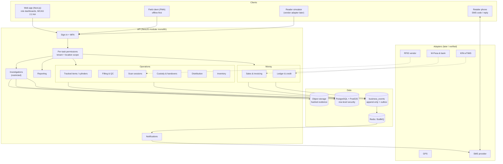
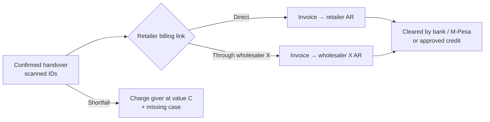

# Diagrams

These are Mermaid diagrams, which GitHub and most editors render. They match the designs approved during discussion.

## System architecture



## Handover with SMS confirmation

```mermaid
sequenceDiagram
  participant G as Giver (driver / wholesaler)
  participant S as System
  participant R as Retailer (registered number)
  G->>S: Scan fulls out + empties in
  S-->>G: Balance check (e.g. 4 out, 4 in, 0 unaccounted)
  G->>S: Request confirmation
  S->>R: SMS with counts, ref and code (15-min window)
  alt Confirmed in time
    R-->>G: Reads code (or replies YES)
    G->>S: Enter code
    S->>S: Custody → retailer; invoice per billing link; events + outbox
  else Replies NO
    S->>S: Freeze, open dispute, alert supervisor
  else No confirmation in 15 min
    S->>S: Unconfirmed: custody stays with giver; alert; case
  end
```

## Money follows confirmed custody


